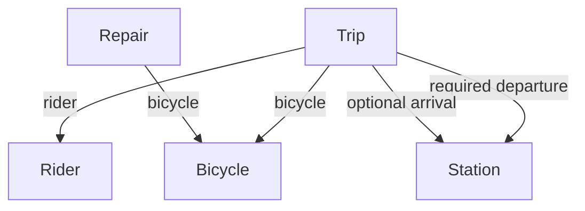

# 1. Setup and database design

[English course](../README.md) · [فارسی](../README.fa.md) · [Next lesson](02-query-fundamentals.md)

## Connect to SQL Server

SQL is the language used to work with relational data. SQL Server is the database engine, T-SQL is its dialect, and SSMS, VS Code, and `sqlcmd` are clients that send queries to the engine.

Use **SQL Server 2022 or later**. Developer Edition is intended for development and testing. You need permission to create a database on a development instance for the setup, and permission to create objects in that database for later lessons. The examples use a dedicated database called `BikeShareTutorialDB`.

- **Windows with SSMS.** Install the Database Engine and SQL Server Management Studio. Connect with Windows Authentication when your account has access. For a default local instance, try `localhost`. For a default Express installation, try `localhost\SQLEXPRESS`. [SQL Server downloads](https://www.microsoft.com/en-us/sql-server/sql-server-downloads) · [Install SSMS](https://learn.microsoft.com/en-us/ssms/install/install)
- **Linux or a Docker lab.** Install SQL Server on a supported Linux distribution or run the container below on an x86-64 Docker host. Connect with the MSSQL extension for VS Code or `sqlcmd`. [Ubuntu installation](https://learn.microsoft.com/en-us/sql/linux/quickstart-install-connect-ubuntu) · [Docker quickstart](https://learn.microsoft.com/en-us/sql/linux/quickstart-install-connect-docker) · [VS Code connection guide](https://learn.microsoft.com/en-us/sql/tools/visual-studio-code-extensions/mssql/mssql-database-connections)
- **An existing development instance.** Use the server name and authentication method your administrator gave you. Use its configured TLS certificate validation for remote connections.

### Docker example with Bash

Enter a strong password when prompted. Docker publishes the port on loopback and stores the database files in a named volume.

```bash
read -rsp 'SQL Server sa password: ' MSSQL_SA_PASSWORD
printf '\n'
export MSSQL_SA_PASSWORD

docker run --detach --name bike-share-sql \
  --env ACCEPT_EULA=Y \
  --env MSSQL_PID=Developer \
  --env MSSQL_SA_PASSWORD \
  --publish 127.0.0.1:1433:1433 \
  --volume bike-share-data:/var/opt/mssql \
  mcr.microsoft.com/mssql/server:2022-latest

unset MSSQL_SA_PASSWORD
docker logs --tail 40 bike-share-sql
```

Wait for SQL Server to report that it is ready for client connections. Use `127.0.0.1,1433` and SQL Server Authentication with the `sa` account for the container. When the local container uses a self-signed certificate, you can select **Trust Server Certificate** specifically for that development connection. To resume the same container later, run `docker start bike-share-sql`.

## Initialize the lab

1. Open and run [00-create-database.sql](../sql/00-create-database.sql) while connected to your development instance.
2. Open and run [01-build-bike-share.sql](../sql/01-build-bike-share.sql). It creates the tables and loads the sample data in one transaction.
3. Check the result grid. You should see **1 Cancelled**, **10 Completed**, and **1 Open** trip.

From a clone or extracted copy of the repository, you can also use the ODBC version of `sqlcmd` against the local Docker example. Each invocation prompts for your password. The `-C` flag trusts the local container's certificate and `-b` makes SQL errors fail the command.

```bash
sqlcmd -S '127.0.0.1,1433' -U sa -C -b -i sql/00-create-database.sql
sqlcmd -S '127.0.0.1,1433' -U sa -C -b -i sql/01-build-bike-share.sql
```

`USE BikeShareTutorialDB` selects the database for the connection. `GO` tells tools such as SSMS and `sqlcmd` to send a batch to SQL Server. Send each batch separately when running the files through an application driver. Local variables live for one batch. A local temporary table can span batches on the same connection.

The setup script skips initialization when all five lab tables already exist. To start with a clean dataset later, use a fresh development instance or change the lab database name consistently in the scripts before running setup.

## Read the schema

| Table | One row represents | Key details |
| --- | --- | --- |
| `dbo.Station` | One docking station | Unique public station code, district, and positive dock capacity |
| `dbo.Bicycle` | One bicycle | Unique bike code, Classic or Electric type, and a flag for whether it is in the fleet |
| `dbo.Rider` | One registered rider | Unique rider code, display name, membership type, and join date |
| `dbo.Trip` | One attempt to rent a bicycle | Links one rider, one bike, and a departure station. A completed trip has an arrival station, end time, and fare. |
| `dbo.Repair` | One maintenance ticket | Links one bike and records when the ticket opened or closed. An open ticket has a missing close date and cost. |



Read the constraints in [the setup script](../sql/01-build-bike-share.sql) next to the seed data.

- A **primary key** identifies a row. `IDENTITY` generates the numeric keys used for joins. A **unique constraint** also protects the human-readable codes, which the seed script uses to look up those keys.
- A **foreign key** requires a referenced row to exist. Each rider and bicycle can occur in many trips, so the trip table records the many-to-many relationship over time.
- A **default** supplies a value when the column is omitted. For example, a new trip defaults to `Open`. **CHECK** constraints validate rules such as the required fields for each trip status. Include explicit `IS NOT NULL` conditions when the rule requires a value in a nullable column.
- Use **`decimal`** for exact fares and costs, **`datetime2`** for trip timestamps, **`date`** for calendar dates, and **`nvarchar`** with `N'…'` for names that may contain Unicode. The sample timestamps use a common lab clock. A real service should define how it stores and converts time zones.

Normalization keeps one rider name and one station name in their own tables. Renaming Cedar Square then requires one row update, and every trip report can show the new name through a join. Captured fares belong to the trip because each trip can have a different price, including a fare of zero.
